  

  
  
  

I build LLM systems for real users: schema-enforced extraction, multi-agent planners and the evals
that keep them honest. On the side, I work on real-time 3D perception.
I'm **AI/ML Lead at KIIT IoT Lab** and **Tech Head at Microsoft Learn Student Ambassadors KIIT**,
and I was an **AI Development Intern at MyRank** (AdaptIQ).

### Featured work

<table>
<tr>
<td width="50%" valign="top">

**[AetherTwin](https://github.com/NamanSingh69/aethertwin-lab)**: LiDAR/RGB-D digital twin of the KIIT IoT Lab.
3D mapping, object tracking and collision-checked path planning; 350+ tests.
 Python · PyTorch · Open3D · Three.js

</td>
<td width="50%" valign="top">

**[Gemini-Jailbreak](https://github.com/NamanSingh69/Gemini-Jailbreak)**: LLM red-teaming lab.
A jailbreak challenge bot for the IoT Lab's cybersecurity event.
 React · TypeScript · Gemini

</td>
</tr>
<tr>
<td valign="top">

**[Deep-Research](https://github.com/NamanSingh69/Deep-Research)**: async research agent.
Recursive search with a SQLite cache, streaming a cited report as it works.
 FastAPI · asyncio · Gemini

</td>
<td valign="top">

**[Auto-MOM](https://github.com/NamanSingh69/Auto-MOM)**: agentic meeting assistant.
Joins a Google Meet, records it and drafts the minutes and follow-up mail.
 TypeScript · Gemini

</td>
</tr>
<tr>
<td valign="top">

**[Question-Paper-Generator](https://github.com/NamanSingh69/Question-Paper-Generator)**: exam papers from course material.
Topic analysis, mixed question types, PDF/HTML/Markdown export.
 Flask · Gemini · Playwright

</td>
<td valign="top">

**[Resume-Scanner](https://github.com/NamanSingh69/Resume-Scanner)** · [live](https://resume-scanner-ats.vercel.app): ATS-style resume scorer.
Keyword and section feedback against a job description.
 Python · spaCy · Docker

</td>
</tr>
</table>

<!-- Add kiit-cse-notes here once it is public and has its first release. -->

### Stack

  

### Activity

  <picture>
    <source media="(prefers-color-scheme: dark)" srcset="https://raw.githubusercontent.com/NamanSingh69/NamanSingh69/output/github-snake-dark.svg">
    
  </picture>

<!-- Add once the Drive file shows v9 (it still shows v8 "5 clients"):

<a href="https://drive.google.com/file/d/1brLXm0ZGWZtmCdCVkbxeNSSV9qZ244AK/view">Resume (PDF)</a>
 -->
