  

  
  

I build LLM systems for real users: schema-enforced extraction, multi-agent planners and the evals
that keep them honest. On the side, I work on real-time 3D perception.
I'm **AI/ML Lead at KIIT IoT Lab** and **Tech Head at Microsoft Learn Student Ambassadors KIIT**,
and I was an **AI Development Intern at MyRank** (AdaptIQ).

### Featured work

  
  
  
  
  
  

More on GitHub: <a href="https://github.com/NamanSingh69/Auto-MOM">Auto-MOM</a> (agentic meeting assistant) · <a href="https://github.com/NamanSingh69/Question-Paper-Generator">Question-Paper-Generator</a> · <a href="https://github.com/NamanSingh69/Resume-Scanner">Resume-Scanner</a>

<!-- Add kiit-cse-notes here once it is public and has its first release. -->

### Stack

  

### Activity

  <picture>
    <source media="(prefers-color-scheme: dark)" srcset="https://raw.githubusercontent.com/NamanSingh69/NamanSingh69/output/github-snake-dark.svg">
    
  </picture>

<!-- Add once the Drive file shows v9 (it still shows v8 "5 clients"):

<a href="https://drive.google.com/file/d/1brLXm0ZGWZtmCdCVkbxeNSSV9qZ244AK/view">Resume (PDF)</a>
 -->
